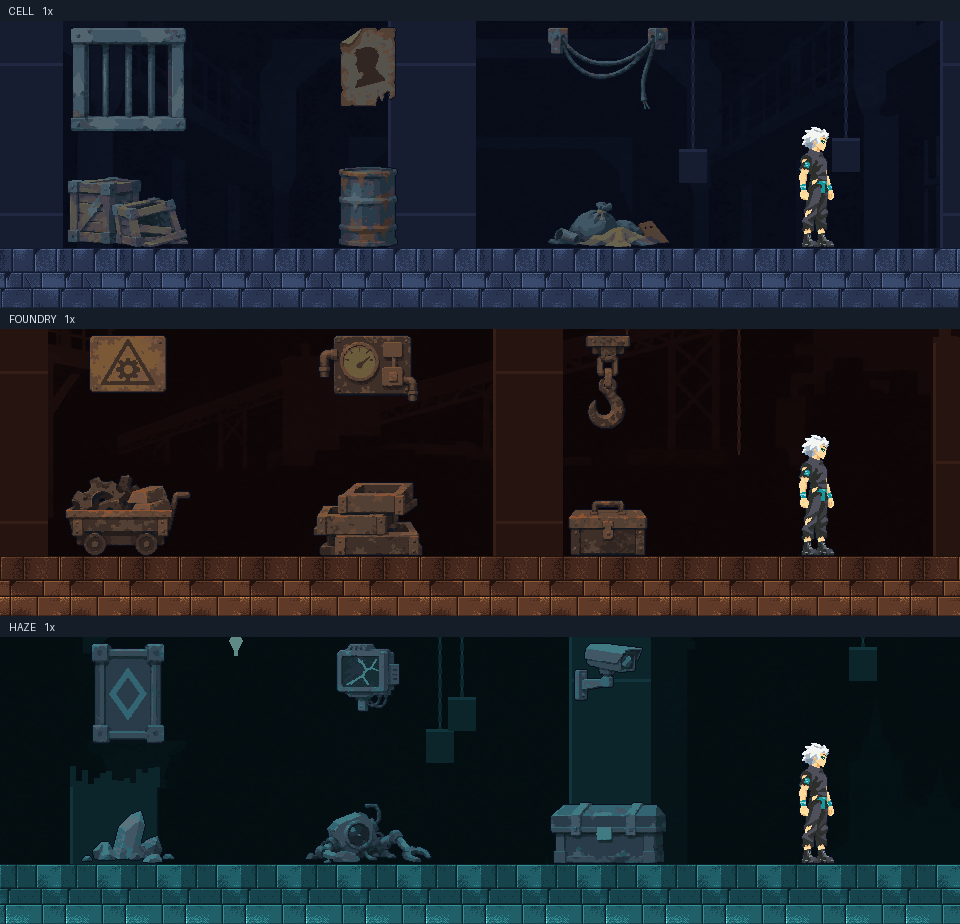

# T31 테마별 방 장식 소품

- 날짜 2026-11-21 [Codex]
- 작업 파일 [T31_room_decor.md](../tasks/T31_room_decor.md)
- 결과 폴더 [room_decor_v1](../../../assets/sprites/forge/room_decor_v1/)
- 상태 `review`

## 만든 파일

바닥 9종과 벽·천장 9종을 1배 PNG로 저장했다. 설치점은 캔버스 왼쪽 위 원점의 픽셀 좌표다. 바닥 소품은 모든 파일에서 불투명 바닥선이 맨 아래 줄에 닿는다.

| 테마 | 소품 | 설치 | 캔버스(px) | 불투명 색 | 설치점 |
|---|---|---|---|---|---|
| 슬럼 | [부서진 나무 상자 더미](../../../assets/sprites/forge/room_decor_v1/cell/broken_crates.png) | 바닥 | 128×75 | 24 | (64, 74) |
| 슬럼 | [녹슨 드럼통](../../../assets/sprites/forge/room_decor_v1/cell/rusty_drum.png) | 바닥 | 66×85 | 22 | (33, 84) |
| 슬럼 | [쓰레기·누더기 더미](../../../assets/sprites/forge/room_decor_v1/cell/rag_heap.png) | 바닥 | 129×50 | 22 | (64, 49) |
| 슬럼 | [철창 창문](../../../assets/sprites/forge/room_decor_v1/cell/barred_window.png) | 벽·천장 | 123×111 | 17 | (61, 3) |
| 슬럼 | [벗겨진 수배 전단](../../../assets/sprites/forge/room_decor_v1/cell/wanted_poster.png) | 벽·천장 | 64×86 | 9 | (32, 3) |
| 슬럼 | [늘어진 전선](../../../assets/sprites/forge/room_decor_v1/cell/sagging_wires.png) | 벽·천장 | 128×89 | 23 | (64, 3) |
| 공장 | [쇳덩이 수레](../../../assets/sprites/forge/room_decor_v1/foundry/scrap_cart.png) | 바닥 | 132×85 | 15 | (66, 84) |
| 공장 | [쌓인 거푸집](../../../assets/sprites/forge/room_decor_v1/foundry/stacked_moulds.png) | 바닥 | 116×77 | 11 | (58, 76) |
| 공장 | [공구함](../../../assets/sprites/forge/room_decor_v1/foundry/tool_chest.png) | 바닥 | 86×59 | 11 | (43, 58) |
| 공장 | [경고 표지판](../../../assets/sprites/forge/room_decor_v1/foundry/warning_sign.png) | 벽·천장 | 84×64 | 10 | (42, 3) |
| 공장 | [벽 계기판](../../../assets/sprites/forge/room_decor_v1/foundry/wall_gauge.png) | 벽·천장 | 107×73 | 15 | (53, 3) |
| 공장 | [매달린 갈고리](../../../assets/sprites/forge/room_decor_v1/foundry/hanging_hook.png) | 벽·천장 | 52×100 | 12 | (26, 3) |
| 탑 | [깨진 헤이즈 결정 조각](../../../assets/sprites/forge/room_decor_v1/haze/broken_crystals.png) | 바닥 | 100×57 | 13 | (50, 56) |
| 탑 | [감시 로봇 잔해](../../../assets/sprites/forge/room_decor_v1/haze/watcher_wreck.png) | 바닥 | 133×64 | 17 | (66, 63) |
| 탑 | [봉인된 상자](../../../assets/sprites/forge/room_decor_v1/haze/sealed_chest.png) | 바닥 | 123×65 | 16 | (61, 64) |
| 탑 | [청록 벽 패널](../../../assets/sprites/forge/room_decor_v1/haze/teal_panel.png) | 벽·천장 | 80×107 | 14 | (40, 3) |
| 탑 | [깨진 모니터](../../../assets/sprites/forge/room_decor_v1/haze/broken_monitor.png) | 벽·천장 | 70×75 | 16 | (35, 3) |
| 탑 | [감시 카메라](../../../assets/sprites/forge/room_decor_v1/haze/watch_camera.png) | 벽·천장 | 75×64 | 16 | (37, 3) |

- 1배 비교 시트 [슬럼](../../../assets/sprites/forge/room_decor_v1/cell_sheet_1x.png), [공장](../../../assets/sprites/forge/room_decor_v1/foundry_sheet_1x.png), [탑](../../../assets/sprites/forge/room_decor_v1/haze_sheet_1x.png)
- 아래 합성판은 실제 원경·중경과 60px 바닥 타일, N-09를 원본 크기로 놓았다. 벽 소품과 바닥 소품의 설치 위치는 검토용 예시다. [1배 합성 미리보기](../../../assets/sprites/forge/room_decor_v1/comparison_1x.png)



## 시도 기록

| 회차 | 작업 | 결과 |
|---|---|---|
| 1 | 슬럼 2×3 시트 | 목재·녹슨 철·누더기, 철창 뒤로 보이는 빈 공간과 글자 없는 얼굴 실루엣을 요청했다. 원화 1회 |
| 2 | 공장 2×3 시트 | 쇳덩이 수레·주물 틀·공구함과 톱니 그림만 있는 경고 표지·계기판·갈고리를 요청했다. 원화 1회 |
| 3 | 탑 2×3 시트 | 저채도 청록 결정과 파손·봉인 장비, 마름모 패널·빈 모니터·카메라를 요청했다. 원화 1회 |
| 마감 보정 | 1배 비교 후 슬럼·탑 색면 정리 | 수배 전단 밝기를 낮추고 원화에 있던 모니터 균열의 대비와 굵기를 높였다. Windows 임시 폴더 이동이 탑과 슬럼에서 한 번씩 실패해 같은 원화로 다시 마감했다 |

각 생성은 순서대로 한 장씩 실행했다. 2×3 마젠타 시트를 키잉한 뒤 18개 셀을 개별로 축소했다. T14·T28과 같은 Hibit 다수결 축소, T28 팔레트를 바탕으로 한 테마별 32색, 이진 알파, 남색 1px 외곽선을 적용했다. 참조 이미지와 프롬프트 전문은 [출처 기록](../../../assets/sprites/forge/room_decor_v1/provenance.json)에 있다.

## 검사

- `check_sprites.py`는 소품별 목표 높이를 지정해 18개 모두 통과했다. 파일별 불투명 색은 9~24색, 반투명은 모두 0픽셀이다. 아래에 [전체 출력](../../../assets/sprites/forge/room_decor_v1/check_sprites.txt)을 첨부했다.
- `python -B tests/test_pixel_assets.py` 8개 통과. 기존 Pillow `getdata` 사용 중단 예정 경고가 표시됐다.
- 셀 경계 침범과 원화 테두리 잘림은 3장 모두 0건이다. 슬럼 원화의 쓰레기·누더기와 전선은 7% 안전 여백 경고가 있었다. 1배에서 두 소품의 양끝이 온전히 들어오고 철창 사이로 배경이 보이는 것을 확인했다. [슬럼](../../../assets/sprites/forge/room_decor_v1/cell/spill/sheet-qc.json) · [공장](../../../assets/sprites/forge/room_decor_v1/foundry/spill/sheet-qc.json) · [탑](../../../assets/sprites/forge/room_decor_v1/haze/spill/sheet-qc.json)
- 합성판에서 18종을 모두 1배로 열어 확인했다. 글자·숫자가 없으며, 수배 전단은 얼굴 실루엣, 경고 표지는 톱니 그림, 벽 패널은 마름모를 사용했다.

<details>
<summary>check_sprites.py 전체 출력</summary>

```text
## cell/broken_crates.png
파일                                           캔버스        내용 WxH     반투명 색
broken_crates.png                            (128, 75)  122x72         0 24
키 72px (목표 72px) OK

통과

## cell/rusty_drum.png
파일                                           캔버스        내용 WxH     반투명 색
rusty_drum.png                               (66, 85)   60x82         0 22
키 82px (목표 81px) OK

통과

## cell/rag_heap.png
파일                                           캔버스        내용 WxH     반투명 색
rag_heap.png                                 (129, 50)  123x47         0 22
키 47px (목표 47px) OK

통과

## cell/barred_window.png
파일                                           캔버스        내용 WxH     반투명 색
barred_window.png                            (123, 111) 117x105        0 17
키 105px (목표 104px) OK

통과

## cell/wanted_poster.png
파일                                           캔버스        내용 WxH     반투명 색
wanted_poster.png                            (64, 86)   58x80         0 9
키 80px (목표 80px) OK

통과

## cell/sagging_wires.png
파일                                           캔버스        내용 WxH     반투명 색
sagging_wires.png                            (128, 89)  122x83         0 23
키 83px (목표 83px) OK

통과

## foundry/scrap_cart.png
파일                                           캔버스        내용 WxH     반투명 색
scrap_cart.png                               (132, 85)  126x82         0 15
키 82px (목표 81px) OK

통과

## foundry/stacked_moulds.png
파일                                           캔버스        내용 WxH     반투명 색
stacked_moulds.png                           (116, 77)  110x74         0 11
키 74px (목표 74px) OK

통과

## foundry/tool_chest.png
파일                                           캔버스        내용 WxH     반투명 색
tool_chest.png                               (86, 59)   80x56         0 11
키 56px (목표 56px) OK

통과

## foundry/warning_sign.png
파일                                           캔버스        내용 WxH     반투명 색
warning_sign.png                             (84, 64)   78x58         0 10
키 58px (목표 58px) OK

통과

## foundry/wall_gauge.png
파일                                           캔버스        내용 WxH     반투명 색
wall_gauge.png                               (107, 73)  101x67         0 15
키 67px (목표 66px) OK

통과

## foundry/hanging_hook.png
파일                                           캔버스        내용 WxH     반투명 색
hanging_hook.png                             (52, 100)  46x94         0 12
키 94px (목표 94px) OK

통과

## haze/broken_crystals.png
파일                                           캔버스        내용 WxH     반투명 색
broken_crystals.png                          (100, 57)  94x54         0 13
키 54px (목표 53px) OK

통과

## haze/watcher_wreck.png
파일                                           캔버스        내용 WxH     반투명 색
watcher_wreck.png                            (133, 64)  127x61         0 17
키 61px (목표 61px) OK

통과

## haze/sealed_chest.png
파일                                           캔버스        내용 WxH     반투명 색
sealed_chest.png                             (123, 65)  117x62         0 16
키 62px (목표 62px) OK

통과

## haze/teal_panel.png
파일                                           캔버스        내용 WxH     반투명 색
teal_panel.png                               (80, 107)  74x101        0 14
키 101px (목표 100px) OK

통과

## haze/broken_monitor.png
파일                                           캔버스        내용 WxH     반투명 색
broken_monitor.png                           (70, 75)   64x69         0 16
키 69px (목표 68px) OK

통과

## haze/watch_camera.png
파일                                           캔버스        내용 WxH     반투명 색
watch_camera.png                             (75, 64)   69x58         0 16
키 58px (목표 58px) OK

통과
```

</details>

## 기준과 달라 보이는 점

- 탑은 청록, 공장은 녹슨 갈색, 슬럼은 회색 철과 흐린 나무색으로 구분된다. 세 합성 예시에서 N-09의 머리와 청록 포인트가 먼저 눈에 들어온다. 소품 최대 sRGB 휘도는 슬럼 98.4, 공장 93.2, 탑 110.3이다. 샘플 바닥 타일의 밝은 픽셀보다 낮지만, 슬럼의 철창과 상자 윗면은 해당 타일의 바탕보다 밝게 보인다. [휘도 측정](../../../assets/sprites/forge/room_decor_v1/comparison_luma.json)
- 감시 카메라의 외곽은 중경 기둥과 같은 청록 계열이어서, 어두운 빈 벽 위에 놓았을 때보다 옆모습이 덜 또렷하다. 공장 갈고리 끝과 슬럼 전선처럼 가는 요소는 최종 1배에서 확인했다.

## 남은 확인

- Hibit의 권장 축소비 경고 `pixel-reduction`은 11종에서 표시됐다. 해당 원화의 출력 픽셀당 원본 픽셀은 2.931~3.736으로 도구 기준 4.0 미만이다. 새 픽셀을 늘리지 않고 요청 해상도에서 마감한 뒤 1배로 확인했다. [슬럼 수치](../../../assets/sprites/forge/room_decor_v1/cell/qa.json) · [공장 수치](../../../assets/sprites/forge/room_decor_v1/foundry/qa.json) · [탑 수치](../../../assets/sprites/forge/room_decor_v1/haze/qa.json)
- 소품 18종을 모두 제출했다. Claude Code가 게임 방에 배치한 뒤 실제 플레이 화면에서 감시 카메라와 전선의 가독성을 확인할 수 있다.

## 사용한 도구

- Codex 내장 `image_gen` 로컬 호스트 경로(모델명 미제공), `generate2dsprite` 및 Agent Sprite Forge Hibit 마감기 0.5.0(MIT), Python·Pillow. 참조·제작 기록은 [provenance.json](../../../assets/sprites/forge/room_decor_v1/provenance.json)에 있다.
