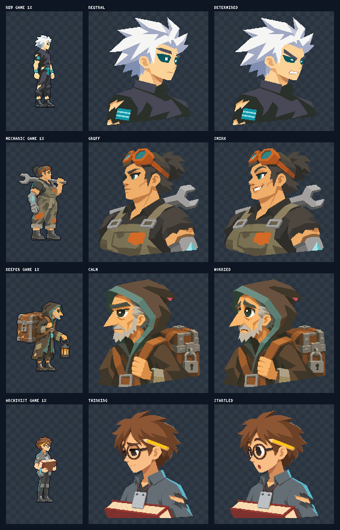

# T32 대화 초상화

- 날짜 2026-11-21 [Codex]
- 작업 파일 [T32_dialog_portraits.md](../tasks/T32_dialog_portraits.md)
- 결과 폴더 [portraits_v1](../../../assets/sprites/forge/portraits_v1/)
- 상태 `review`

## 만든 파일

| 인물 | 표정 1 | 표정 2 | 방향 | 불투명 영역(px) |
|---|---|---|---|---|
| N-09 | [무표정](../../../assets/sprites/forge/portraits_v1/n09_1.png) | [이를 악문 결의](../../../assets/sprites/forge/portraits_v1/n09_2.png) | 오른쪽 | 144×180 |
| 정비사 | [무뚝뚝](../../../assets/sprites/forge/portraits_v1/mechanic_1.png) | [씩 웃음](../../../assets/sprites/forge/portraits_v1/mechanic_2.png) | 왼쪽 | 168×180 |
| 보관인 | [차분](../../../assets/sprites/forge/portraits_v1/keeper_1.png) | [걱정](../../../assets/sprites/forge/portraits_v1/keeper_2.png) | 왼쪽 | 172×180 |
| 기록관 | [생각에 잠김](../../../assets/sprites/forge/portraits_v1/archivist_1.png) | [놀람](../../../assets/sprites/forge/portraits_v1/archivist_2.png) | 왼쪽 | 148×180 |

PNG는 모두 200×200이고, 표정 두 장의 위쪽 여백은 10px로 같다. 인물마다 공용 팔레트 32색을 사용했으며, 반투명 픽셀은 8장 모두 0개다. 아래 비교판은 왼쪽의 실제 게임 대기 스프라이트와 오른쪽 두 표정을 모두 1배로 배치했다. [1배 비교판](../../../assets/sprites/forge/portraits_v1/sheet_1x.png)



## 시도 기록

| 순서 | 생성 | 확인·마감 |
|---|---|---|
| 1 | N-09 두 표정 1회 | 흰색 뾰족한 머리와 찢어진 검은 옷, 청록 팔띠를 유지했다. |
| 2 | 정비사 두 표정 1회 | 이마의 주황 고글과 올리브 작업복, 렌치와 의수를 유지했다. |
| 3 | 보관인 두 표정 1회 | 청록 띠가 있는 후드, 회색 수염과 자물쇠 달린 나무 상자를 유지했다. |
| 4 | 기록관 두 표정 1회 | 둥근 안경, 귀의 연필, 금속 수인표와 장부를 유지했다. 오른쪽을 보고 나온 두 컷은 각각 마감 전에 좌우 반전했다. |

마스터의 상반신과 실제 대기 스프라이트를 한 참조판에 놓고 인물별로 첨부했다. 동일한 구도에서 입과 눈썹을 바꾼 두 컷을 마젠타 시트 한 장에 요청했다. 총 4회 생성했고 재생성은 없었다. [실제 프롬프트와 원화 경로](../../../assets/sprites/forge/portraits_v1/provenance.json)

마젠타 키잉 후 셀마다 알파 경계를 잡아 잘랐다. 같은 인물의 두 컷을 같은 배율로 최근접 축소 한 번씩 적용해 200×200에 등록했다. 두 표정의 불투명 픽셀에서 32색 공용 OKLab 팔레트를 학습하고, 알파 128을 경계로 투명과 불투명을 나눴다. 도트 무늬를 추가하지 않았다. [마감 스크립트](../../../assets/sprites/forge/portraits_v1/finish.py)

## 검사

- 200×200, 알파 0·255, 인물별 공용 32색, 원화 셀 경계의 여백과 최종 캔버스 여백을 확인했다. 마젠타 잔색은 색 검사에서 0픽셀이고, 비교판에서도 마젠타 테두리가 보이지 않았다.
- 네 쌍의 불투명 실루엣 교집합을 합집합으로 나눈 값은 0.997~0.999다. 머리·어깨 위치가 유지되며 입과 눈썹의 차이가 보이는 것을 1배에서 확인했다. [N-09 수치](../../../assets/sprites/forge/portraits_v1/source/n09_qa.json) · [정비사 수치](../../../assets/sprites/forge/portraits_v1/source/mechanic_qa.json) · [보관인 수치](../../../assets/sprites/forge/portraits_v1/source/keeper_qa.json) · [기록관 수치](../../../assets/sprites/forge/portraits_v1/source/archivist_qa.json)
- `check_sprites.py`는 인물별 두 장씩 검사해 4쌍 모두 통과했다. 상반신 그림이므로 전신 키와 발 접지를 적용하지 않았다. `python -B tests/test_pixel_assets.py` 8개 통과. 기존 Pillow `getdata` 사용 중단 예정 경고 2건이 표시됐다.

## check_sprites.py 결과 전체

[검사 출력 파일](../../../assets/sprites/forge/portraits_v1/check_sprites.txt)

```text
## n09 1·2 (--air)
파일                                           캔버스        내용 WxH     반투명 색
n09_1.png                                    (200, 200) 144x180        0 32
n09_2.png                                    (200, 200) 144x180        0 32

통과

## mechanic 1·2 (--air)
파일                                           캔버스        내용 WxH     반투명 색
mechanic_1.png                               (200, 200) 168x180        0 32
mechanic_2.png                               (200, 200) 168x180        0 32
목표 키를 찾지 못해 키 검사는 건너뜁니다 (--height 지정 가능)

통과

## keeper 1·2 (--air)
파일                                           캔버스        내용 WxH     반투명 색
keeper_1.png                                 (200, 200) 172x180        0 32
keeper_2.png                                 (200, 200) 172x180        0 32
목표 키를 찾지 못해 키 검사는 건너뜁니다 (--height 지정 가능)

통과

## archivist 1·2 (--air)
파일                                           캔버스        내용 WxH     반투명 색
archivist_1.png                              (200, 200) 148x180        0 32
archivist_2.png                              (200, 200) 148x180        0 32
목표 키를 찾지 못해 키 검사는 건너뜁니다 (--height 지정 가능)

통과
```

## 기준과 달라 보이는 점

- 전신 스프라이트보다 눈·눈썹과 입의 면적을 키웠다. N-09는 옆모습보다 살짝 정면을 보고, 흰 머리카락 끝이 조금 더 길고 날카롭게 보인다.
- 정비사는 렌치 자루를 줄이고 머리 부분을 남겼다. 보관인의 등불은 흉상 범위 밖이라 보이지 않는다. 기록관은 안경테가 상대적으로 크고 장부는 상단만 보인다.
- 얼굴은 눈과 입을 쉽게 읽을 수 있도록 전신보다 밝은 색면 위주로 남겼다. 머리카락과 피부 가장자리에 청록 림라이트를 쓰지 않았다.

## 남은 확인

은신처 대화 UI에 배치한 상태의 실제 가독성은 확인 전이다. 비교판에서 보관인의 걱정은 입보다 눈과 눈썹에서 먼저 읽혀 네 쌍 중 표정 차이가 가장 미묘하다.

## 사용한 도구

Codex 내장 `image_gen` 호스트 경로(모델명 미제공), `generate2dsprite` 0.5.0의 키잉 및 팔레트 도구와 Python·Pillow, `codixel`(MIT)의 1배 비교판. [호스트 경로 확인](../../../assets/sprites/forge/portraits_v1/source/doctor.json)
