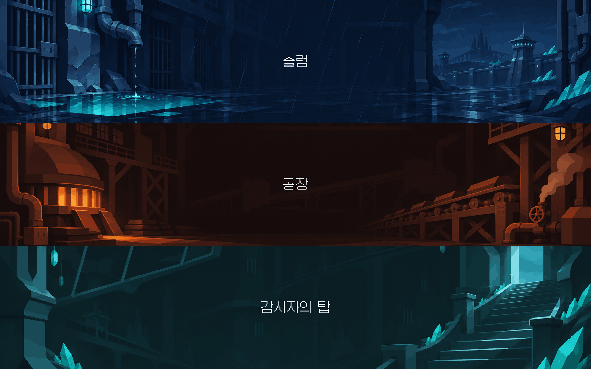

# T33 구역 제목 카드 일러스트

- 날짜 2026-11-21 [Codex]
- 작업 파일 [T33_zone_cards.md](../tasks/T33_zone_cards.md)
- 결과 폴더 [zone_cards_v1](../../../assets/sprites/forge/zone_cards_v1/)
- 상태 `review`

## 만든 파일

| 그림 | 장면과 색 |
|---|---|
| [zone_cell.png](../../../assets/sprites/forge/zone_cards_v1/zone_cell.png) | 남색 감옥 골목, 빗줄기와 청록 헤이즈 웅덩이, 오른쪽의 먼 감옥 탑 |
| [zone_foundry.png](../../../assets/sprites/forge/zone_cards_v1/zone_foundry.png) | 녹슨 강철 구조물과 주황빛 용광로, 반대편의 컨베이어와 증기 |
| [zone_haze.png](../../../assets/sprites/forge/zone_cards_v1/zone_haze.png) | 청록 결정이 자란 탑 계단, 오른쪽 위 밝은 출입구 |

게임용 세 PNG는 모두 1920×400, 불투명 32색이며 글자와 인물 없이 저장했다. 그림을 늘리거나 줄이지 않고 위에서부터 슬럼, 공장, 탑 순서로 배치했다. [세로 비교판](../../../assets/sprites/forge/zone_cards_v1/sheet_1x.png)

갈무리 42px로 실제 제목과 비슷한 예시 문구를 얹어 1배로 확인했다. 중앙 제목의 위치는 각 카드의 (960, 200)이다. [예시 제목 합성판](../../../assets/sprites/forge/zone_cards_v1/preview_titles_1x.png)



## 시도 기록

| 순서 | 생성 | 결과 |
|---|---|---|
| 1 | 슬럼 첫 원화 | 해당 원경의 철창과 제목 화면의 감옥 탑 실루엣을 참조했다. 첫 화면비 변환에서 왼쪽 웅덩이와 오른쪽 탑의 꼭대기가 양끝에 걸렸다. |
| 2 | 공장 원화 | 갈색 원경의 철골, 왼쪽의 용광로, 오른쪽의 컨베이어와 증기를 요청했다. 한 번 생성했다. |
| 3 | 탑 원화 | 원경의 청록색을 바탕으로 결정과 오른쪽의 상승 계단, 위쪽 출입구를 요청했다. 한 번 생성했다. |
| 4 | 슬럼 구도 보정 | 첫 원화에서 땅과 웅덩이를 위로 올리고, 감옥 탑을 작고 낮게 배치했다. 두 요소가 1920×400 안에 들어오는 두 번째 원화를 채택했다. |

원화 4장을 한 장씩 생성했다. 모두 2172×724로 반환됐다. T16과 같이 `conform_background.py`로 비율을 유지해 0.884배 Lanczos 축소 및 1920×400 크롭을 적용했다. 이후 `hibit_plate.py`에서 32색, `--smooth 0 --preview-scale 1`로 마감해 1배 PNG를 얻었다. [프롬프트·원본 경로와 해시](../../../assets/sprites/forge/zone_cards_v1/provenance.json) · [마감 스크립트](../../../assets/sprites/forge/zone_cards_v1/prepare.py)

## 검사

- 세 그림을 1배로 각각 확인했다. 세 장소는 남색 빗골목, 녹갈색 공업 공간, 청록 탑의 계단으로 구분된다. 중앙의 어두운 배경 위에서 예시 제목도 세 장 모두 읽힌다.
- 예시 제목 획의 가장 낮은 상대 휘도 대비는 슬럼 11.85:1, 공장 16.18:1, 탑 13.69:1이다. 중앙 가로 640px의 휘도 95백분위는 각 카드에서 좌우 영역보다 낮다. [좌표와 측정값](../../../assets/sprites/forge/zone_cards_v1/qa_zone_cards.json)
- `check_sprites.py` 개별 검사 3장 통과. 크기는 모두 1920×400, 반투명과 투명은 0픽셀, 고유색은 각 32개다. `python -B tests/test_pixel_assets.py` 8개 통과. 기존 Pillow `getdata` 사용 중단 예정 경고 2건이 표시됐다.
- Hibit 검사에서는 T16과 같은 `reduction: 1.0 (threshold 2.0)` 경고가 있었다. 두 번째 마감의 입력과 출력 크기가 같아 한 출력 픽셀에 대한 원화 표본 수가 적다는 뜻이다. 양자화 후 슬럼의 반사와 탑의 희미한 안개에 작은 색면 경계가 보인다. [슬럼 1차](../../../assets/sprites/forge/zone_cards_v1/finish/cell/v1/hibit/plate.json) · [슬럼 최종](../../../assets/sprites/forge/zone_cards_v1/finish/cell/v2/hibit/plate.json) · [공장](../../../assets/sprites/forge/zone_cards_v1/finish/foundry/v1/hibit/plate.json) · [탑](../../../assets/sprites/forge/zone_cards_v1/finish/haze/v1/hibit/plate.json)

## check_sprites.py 결과 전체

[전체 출력 파일](../../../assets/sprites/forge/zone_cards_v1/check_sprites.txt)

```text
## zone_cell.png
파일                                           캔버스        내용 WxH     반투명 색
zone_cell.png                                (1920, 400) 1920x400        0 32
목표 키를 찾지 못해 키 검사는 건너뜁니다 (--height 지정 가능)

통과

## zone_foundry.png
파일                                           캔버스        내용 WxH     반투명 색
zone_foundry.png                             (1920, 400) 1920x400        0 32
목표 키를 찾지 못해 키 검사는 건너뜁니다 (--height 지정 가능)

통과

## zone_haze.png
파일                                           캔버스        내용 WxH     반투명 색
zone_haze.png                                (1920, 400) 1920x400        0 32
목표 키를 찾지 못해 키 검사는 건너뜁니다 (--height 지정 가능)

통과
```

## 기준과 달라 보이는 점

- 슬럼은 어두운 감방 원경에서 골목 바깥이 보이도록 시점을 바꿨다. 비와 웅덩이 반사를 살리면서 양옆 청록색은 원경보다 밝아졌다.
- 공장은 용광로와 컨베이어를 자세히 보이는 거리로 가져왔다. 짙은 밤색과 녹슨 철골은 원경에서 가져왔고 용광로 쪽에 가장 강한 주황색을 썼다.
- 탑은 원경의 아치와 청록색을 가져와 계단 가까이에서 올려다보는 구도로 바꿨다. 좁은 띠에서 계단과 결정을 함께 담아 상단 아치 꼭대기 일부가 화면 밖으로 나간다.

## 남은 확인

게임 전환 중 제목과 카드가 함께 뜨는 화면은 아직 확인하지 않았다. 슬럼의 웅덩이 끝이 중앙 1/3 왼쪽 아래에 조금 들어오는 구도라 예시 위치에서 크게 벗어난 하단 배치에서는 글자가 약하게 보일 수 있다.

## 사용한 도구

Codex 내장 `image_gen` 호스트 경로(모델명·비용 추정 미제공), `generate2dmap` 0.5.0(MIT), Pillow, `codixel`(MIT) 1배 비교판. 예시 제목에만 프로젝트 갈무리(SIL OFL 1.1)를 사용했다. [호스트 경로 확인](../../../assets/sprites/forge/zone_cards_v1/source/doctor.json)
