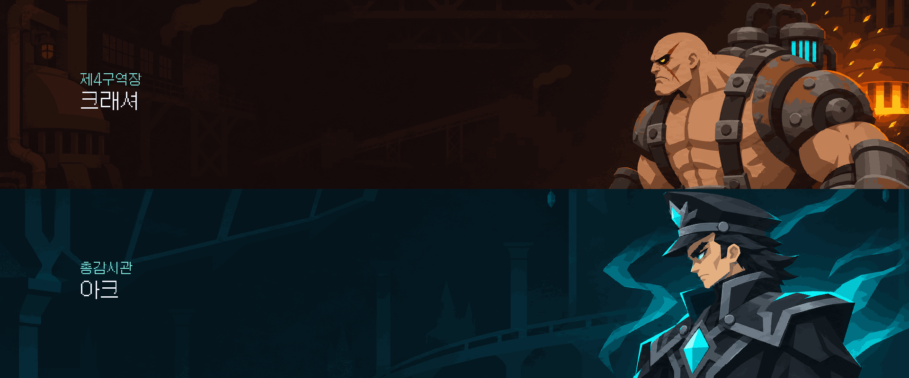

# T34 보스 등장 카드

- 날짜 2026-11-21 [Codex]
- 작업 파일 [T34_boss_cards.md](../tasks/T34_boss_cards.md)
- 결과 폴더 [boss_cards_v1](../../../assets/sprites/forge/boss_cards_v1/)
- 상태 `review`

## 만든 파일

| PNG | 장면 |
|---|---|
| [boss_card_crasher.png](../../../assets/sprites/forge/boss_cards_v1/boss_card_crasher.png) | 오른쪽에서 왼쪽을 노려보는 크래셔. 흉터, 녹슨 어깨 장갑과 청록 냉각통, 뒤편 용광로 불빛과 불똥 |
| [boss_card_ark.png](../../../assets/sprites/forge/boss_cards_v1/boss_card_ark.png) | 오른쪽에서 왼쪽을 내려다보는 아크. 제복 모자, 긴 코트의 높은 깃과 가슴 결정, 청록 헤이즈 소용돌이 |
| [sheet_1x.png](../../../assets/sprites/forge/boss_cards_v1/sheet_1x.png) | 두 카드를 위에서부터 크래셔, 아크 순으로 나열한 비교판 |
| [preview_titles_1x.png](../../../assets/sprites/forge/boss_cards_v1/preview_titles_1x.png) | 왼쪽에 별칭과 이름 두 줄을 얹은 배치 검토판 |

게임용 카드는 각각 1920×400, 불투명 32색이며 글자 없이 저장했다. 예시 제목만 28px·42px 갈무리로 각각 왼쪽 x≈170, y=154와 194에 그렸다.



## 시도 기록

| 순서 | 원화 | 결과 |
|---|---|---|
| 1 | 크래셔 | 마스터와 실제 스프라이트의 맨머리와 흉터, 맨가슴의 고정대, 녹슨 장갑과 청록 냉각통을 참조했다. 왼팔이 왼쪽 글자 영역 아래로 걸쳤고 불똥이 거의 보이지 않았다. |
| 2 | 아크 | 마스터와 게임 그림, 상점 일러스트에서 모자·제복·가슴 결정의 생김새를 참조했다. 400px 띠에서 모자와 가슴 결정을 동시에 담기 어려웠다. |
| 3 | 크래셔 구도 보정 | 오른쪽으로 옮겨 왼쪽 영역을 비웠다. 용광로 주변에 주황색 불똥을 추가하고 왼쪽 등불을 눌렀다. |
| 4 | 아크 구도 보정 | 인물을 화면 안에서 조금 작게 잡고 모자의 위치를 내렸다. 모자와 가슴 결정 끝이 같은 띠에 들어온다. |

원화는 크래셔 2회, 아크 2회로 총 4장이다. 각 보스의 공장·탑·보스방 원경에서 배경색을 가져왔다. [프롬프트 전문·참조·원화 해시](../../../assets/sprites/forge/boss_cards_v1/provenance.json) · [크래셔 기준판](../../../assets/sprites/forge/boss_cards_v1/source/crasher_reference.png) · [아크 기준판](../../../assets/sprites/forge/boss_cards_v1/source/ark_reference.png)

T33과 같이 2172×724 원화에 Lanczos 비율 유지 축소(0.884배)와 `conform_background.py`의 1920×400 크롭을 적용했다. `hibit_plate.py`에서 32색, `--smooth 0 --preview-scale 1`로 마감했다. 완성 PNG와 비교판의 카드 영역은 1배다. [마감 스크립트](../../../assets/sprites/forge/boss_cards_v1/build_cards.py)

## 검사

- 두 완성 카드와 예시 합성판을 1배로 열어 확인했다. 크래셔의 흉터·냉각통, 아크의 모자·가슴 결정이 보이고, 왼쪽의 이름과 별칭은 인물이나 효과에 겹치지 않는다.
- 예시 글자 획의 가장 낮은 상대 휘도 대비는 크래셔 별칭 12.78:1·이름 15.34:1, 아크 별칭 10.84:1·이름 16.45:1이다. 전체 왼쪽 1280px의 휘도 95백분위는 크래셔 0.0084, 아크 0.0188로, 각각 오른쪽 0.3038, 0.3198보다 낮았다. [측정 좌표와 값](../../../assets/sprites/forge/boss_cards_v1/qa_boss_cards.json)
- `check_sprites.py` 2장 통과. 각 파일 1920×400, 32색, 투명·반투명 0픽셀을 확인했다. `python -B tests/test_pixel_assets.py` 8개 통과. 기존 Pillow `getdata` 사용 중단 예정 경고 2건이 표시됐다.
- Hibit 마감의 `reduction: 1.0 (threshold 2.0)` 경고는 마감을 실행한 3판 모두에서 표시됐다. T33과 같이 히비트 마감 입력과 출력이 같은 크기라 다수결에 쓰는 원화 표본 수가 적다. [크래셔 첫 마감](../../../assets/sprites/forge/boss_cards_v1/finish/crasher/v1/hibit/plate.json) · [크래셔 최종](../../../assets/sprites/forge/boss_cards_v1/finish/crasher/v2/hibit/plate.json) · [아크 최종](../../../assets/sprites/forge/boss_cards_v1/finish/ark/v2/hibit/plate.json)

## check_sprites.py 결과 전체

[전체 검사 출력](../../../assets/sprites/forge/boss_cards_v1/check_sprites.txt)

```text
## boss_card_crasher.png
파일                                           캔버스        내용 WxH     반투명 색
boss_card_crasher.png                        (1920, 400) 1920x400        0 32
목표 키를 찾지 못해 키 검사는 건너뜁니다 (--height 지정 가능)

통과

## boss_card_ark.png
파일                                           캔버스        내용 WxH     반투명 색
boss_card_ark.png                            (1920, 400) 1920x400        0 32
목표 키를 찾지 못해 키 검사는 건너뜁니다 (--height 지정 가능)

통과
```

## 기준과 달라 보이는 점

- 크래셔의 흉터는 용광로 조명 아래에서 원본의 붉은색보다 어두운 적갈색으로 보인다. 상반신 구도에서 팔뚝 끝과 허리 장치는 띠 밖에 있고, 오른쪽 어깨와 청록 냉각통으로 외형을 확인할 수 있다.
- 아크의 모자는 게임의 작은 전신 그림보다 챙이 넓게 읽히며 고개를 더 숙여 보인다. 회색 제복선과 청록 가슴 결정은 남겼다. 모자와 결정 끝의 위아래 여백은 다소 좁고, 소용돌이의 어두운 끝이 왼쪽 제목 영역의 오른쪽 경계에 조금 들어온다.

## 남은 확인

게임에서 띠가 열리고 닫힐 때의 모습은 아직 확인하지 않았다. 아크 모자와 가슴 결정은 띠를 충분히 열었을 때 둘 다 보인다.

## 사용한 도구

Codex 내장 `image_gen` 호스트 경로(모델명·비용 추정 미제공), `generate2dmap` 0.5.0(MIT), `codixel`(MIT) 비교판, Python·Pillow. 예시 제목에 프로젝트 갈무리(SIL OFL 1.1)를 썼다. [호스트 경로 확인](../../../assets/sprites/forge/boss_cards_v1/source/doctor.json)
