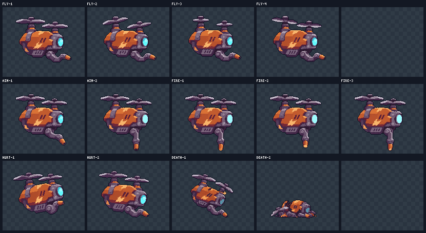

# T36 용접 드론

- 날짜 2026-11-22 [Codex]
- 작업 파일 [T36_enemy_drone.md](../tasks/T36_enemy_drone.md)
- 결과 폴더 [drone_v1](../../../assets/sprites/forge/drone_v1/)
- 상태 `review`

## 만든 파일

| 대상 | 장수 | 내용과 미리보기 |
|---|---:|---|
| 마스터 | 1 | [키잉 원화](../../../assets/sprites/forge/drone_v1/master/master_rgba.png), [90px 마감](../../../assets/sprites/forge/drone_v1/enemy_drone_idle.png) |
| 비행 | 4 | `fly-1`~`fly-4`, 같은 위치에서 로터 회전과 위아래 2px 움직임. [1배 GIF](../../../assets/sprites/forge/drone_v1/fly_1x.gif) |
| 공격 예고 | 2 | `aim-1`~`aim-2`, 비스듬한 토치가 수직 아래를 향하고 렌즈가 밝아짐. [1배 GIF](../../../assets/sprites/forge/drone_v1/aim_1x.gif) |
| 분사 | 3 | `fire-1`~`fire-3`, 노즐 점등과 짧은 반동. 분사 불꽃은 게임에서 그린다. [1배 GIF](../../../assets/sprites/forge/drone_v1/fire_1x.gif) |
| 피격 | 2 | `hurt-1`~`hurt-2`, 오른쪽 렌즈 쪽이 올라갔다가 반대로 숙여짐. [1배 GIF](../../../assets/sprites/forge/drone_v1/hurt_1x.gif) |
| 사망 | 2 | `death-1`~`death-2`, 불똥을 내며 고개가 기울고 바닥의 낮은 잔해로 이어짐. [1배 GIF](../../../assets/sprites/forge/drone_v1/death_1x.gif) |

[최종 프레임 13장](../../../assets/sprites/forge/drone_v1/frames/)은 모두 **160×136px**, 왼쪽 위 원점 기준 공통 몸통 중심은 **(73, 65)**다. 투명 여백까지 포함한 게임용 캔버스 좌표다. 사망 잔해에서 맨 아래 불투명 줄은 **y=112**다. [1배 동작 비교판](../../../assets/sprites/forge/drone_v1/comparison_1x.png) · [공장 원경·타일·기존 적과 1배 비교](../../../assets/sprites/forge/drone_v1/foundry_1x.png)



## 시도 기록

마스터 → 비행(2×2) → 예고·분사(2×3 중 5칸) → 피격(1×2) → 사망(1×2) 순서로 각 원화를 한 번씩 생성했다. 총 5회다. 마스터는 공장 원경·타일과 간수·투척병·크래셔의 철 재질과 청록 강조색을 참조했다. 네 시트에는 승인한 마스터를 참조로 붙이고 동작에 필요한 로터·토치·각도만 지정했다. [프롬프트·원화·해시](../../../assets/sprites/forge/drone_v1/provenance.json)

`master_still.py approve`로 키잉한 뒤 `tools/finish_character.py <master_rgba> enemy_drone --height 90`을 사용했다. 동작 시트는 `generate2dsprite.py process`에서 키잉·분리했다. 주황색 몸통과 청록색 렌즈를 기준으로 원화 배율과 위치를 등록하고 `--like enemy_drone`으로 마스터와 같은 팔레트·축척을 적용했다. 완성 픽셀은 공통 캔버스로 정수 이동했다. 피격 2컷째의 최종 x 위치를 4px 왼쪽으로 맞췄다. 사망 첫 컷에서는 원화의 불똥이 고립점 정리에서 사라져, 원화에 이미 있는 작은 불똥의 윤곽의 테두리를 넓혀 다시 마감했다. [등록·검토 스크립트](../../../assets/sprites/forge/drone_v1/prepare.py)

## 검사

- 마스터 불투명 영역 **111×90px**로 목표 키 통과. 최종 13장은 모두 반투명 0px, 파일별 35~38색, 전체 공용 41색이다. 마젠타에 가까운 고채도 픽셀은 최종 프레임에서 0개였다. `check_sprites.py --air`는 사망 잔해, 토치 길이, 공중 위치에 전신 발 접지 기준을 적용하지 않았다.
- 비행의 주황 몸통 중심 y는 **63.5 → 62.5 → 61.5 → 62.5px**, x 차이 최대 0.5px다. 예고·분사의 몸통 중심 y는 64px이고 x 차이 최대 0.5px다. 렌즈의 평균 sRGB 휘도는 예고 1에서 210.3, 예고 2에서 230.7이다. 분사 중에는 아래 노즐만 가열되고 반동 컷에서 토치가 6px 올라간다. [프레임별 측정](../../../assets/sprites/forge/drone_v1/qa_frames.json)
- GIF 5개의 프레임 순서, 1배 합성 픽셀, 재생 시간을 다시 읽어 확인했다. 비행 GIF만 반복한다. 시간은 검토용이다.
- `python -B tests/test_pixel_assets.py` 8개 통과. Pillow `getdata` 사용 중단 예정 경고 2건은 기존 검사에서 나왔다.

## 도구 경고

| 파일 | 경고 | 값 | 기준 |
|---|---|---:|---:|
| [마스터](../../../assets/sprites/forge/drone_v1/master/master.json) | 원화 불투명 높이 713px를 730px로 프레이밍하면서 확대 | 1.02배 | 1배 |
| [비행 원화 검사](../../../assets/sprites/forge/drone_v1/source/fly_spill/sheet-qc.json) | `safe_frame`, 1·3번 원화가 5.5% 여백 안쪽에 접근 | 2칸 | 0 |
| [사망 원화 검사](../../../assets/sprites/forge/drone_v1/source/death_spill/sheet-qc.json) | `safe_frame`, 2번 원화가 5.5% 여백 안쪽에 접근 | 1칸 | 0 |
| [비행 키잉](../../../assets/sprites/forge/drone_v1/source/fly_processed/pipeline-meta.json) | `key_ring_spill` | 0.365642 | 0.01 |
| [공격 키잉](../../../assets/sprites/forge/drone_v1/source/attack_processed/pipeline-meta.json) | `key_ring_spill` | 0.339002 | 0.01 |
| [피격 키잉](../../../assets/sprites/forge/drone_v1/source/hurt_processed/pipeline-meta.json) | `key_ring_spill` | 0.421376 | 0.01 |
| [사망 키잉](../../../assets/sprites/forge/drone_v1/source/death_processed/pipeline-meta.json) | `key_ring_spill` | 0.047857 | 0.01 |

원화 키잉에는 테두리 색 경고가 남았다. 최종 1배에서 뚜렷한 마젠타 테두리나 로터·잔해 잘림이 보이지 않았다. 마스터 및 최종 Hibit 마감의 수치 검사에는 추가 경고가 없었다.

## check_sprites.py 결과 전체

[전체 검사 출력](../../../assets/sprites/forge/drone_v1/check_sprites.txt)

```text
MASTER --height 90
파일                                           캔버스        내용 WxH     반투명 색
enemy_drone_idle.png                         (113, 92)  111x90         0 39
키 90px (목표 90px) OK

통과
13 FRAMES --air
파일                                           캔버스        내용 WxH     반투명 색
aim-1.png                                    (160, 136) 101x101        0 36
aim-2.png                                    (160, 136) 101x112        0 36
death-1.png                                  (160, 136) 84x86         0 36
death-2.png                                  (160, 136) 90x37         0 38
fire-1.png                                   (160, 136) 101x112        0 36
fire-2.png                                   (160, 136) 101x106        0 35
fire-3.png                                   (160, 136) 101x112        0 37
fly-1.png                                    (160, 136) 109x90         0 38
fly-2.png                                    (160, 136) 106x90         0 36
fly-3.png                                    (160, 136) 103x90         0 37
fly-4.png                                    (160, 136) 106x91         0 37
hurt-1.png                                   (160, 136) 101x83         0 38
hurt-2.png                                   (160, 136) 99x92         0 38
목표 키를 찾지 못해 키 검사는 건너뜁니다 (--height 지정 가능)

통과
```

## 기준과 달라 보이는 점

- 기존 적과 1배로 놓았을 때 둥근 주황 몸통, 두 로터와 청록색 눈이 공중에 드러나 지상의 네 적과 실루엣이 겹치지 않는다. 드론의 강철 그림자는 간수·크래셔보다 보랏빛이 강하다.
- 아래로 향하는 토치가 1배에서 보이고, 대기 중 청록 렌즈가 가열 전 밝은 흰청록으로 바뀐다. 토치의 돌출로 공격 자세 전체 높이가 112px까지 커지지만 몸통은 거의 움직이지 않는다.
- 사망 불똥은 로터 연결부 근처에서 작은 주황 덩어리로 보인다. 첫 장은 추락 자세, 둘째는 낮은 파편 더미로 읽힌다. 잔해의 불투명 높이는 37px다.

## 남은 확인

아직 게임에 배치한 상태에서 아래쪽 분사 이펙트와 예고 프레임의 타이밍을 확인하지 않았다. 검토 GIF는 자리 고정 상태에서 자세와 순서를 보여 준다.

## 사용한 도구

Codex 내장 `image_gen` 호스트 경로(모델명·비용 추정 미제공), `generate2dsprite`와 Agent Sprite Forge Hibit 마감기 0.5.0(MIT), `codixel`(MIT) 비교판, Python·Pillow. [호스트 경로 확인](../../../assets/sprites/forge/drone_v1/source/doctor.json)
