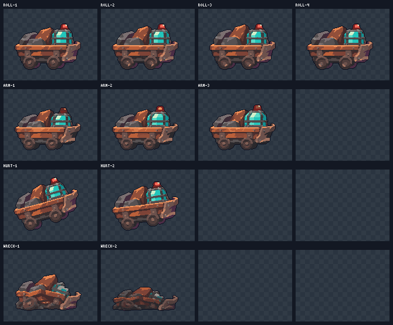

# T37 자폭 수레

- 날짜 2026-11-22 [Codex]
- 작업 파일 [T37_enemy_cart.md](../tasks/T37_enemy_cart.md)
- 결과 폴더 [cart_v1](../../../assets/sprites/forge/cart_v1/)
- 상태 `review`

## 만든 파일

| 동작 | 장수 | 내용 |
|---|---:|---|
| 마스터 | 1 | [키잉 원화](../../../assets/sprites/forge/cart_v1/master/master_rgba.png) · [75px 마감](../../../assets/sprites/forge/cart_v1/enemy_cart_idle.png) |
| 굴러감 | 4 | 바퀴 허브가 돌고, 맨 위 고철이 덜컹인다. [GIF](../../../assets/sprites/forge/cart_v1/roll_1x.gif) |
| 예고 | 3 | 통이 세 단계로 부풀고 경고등은 2컷째에 가장 밝다. [GIF](../../../assets/sprites/forge/cart_v1/arm_1x.gif) |
| 피격 | 2 | 뒤 바퀴에 무게가 실리면서 찌그러진 앞 범퍼와 앞바퀴가 들린다. [GIF](../../../assets/sprites/forge/cart_v1/hurt_1x.gif) |
| 잔해 | 2 | 막 주저앉은 그을린 수레와 더 낮게 가라앉은 잔해. [GIF](../../../assets/sprites/forge/cart_v1/wreck_1x.gif) |

[최종 프레임 11장](../../../assets/sprites/forge/cart_v1/frames/)은 공통 **160×122px** 캔버스를 사용한다. 왼쪽 위 기준 **(76, 104)**가 수레의 배치점이며 y=104는 바닥 경계, **y=103**은 모든 컷의 마지막 불투명 줄이다. [1배 동작 비교판](../../../assets/sprites/forge/cart_v1/comparison_1x.png) · [실제 공장 원경·타일과 기존 적 옆 1배 비교](../../../assets/sprites/forge/cart_v1/foundry_1x.png)



## 시도 기록

1. 간수, 크래셔, 기존 공장 장식 수레와 원경·타일로 녹슨 주황 철판과 어두운 강철 재질을 정했다. 마스터에는 바퀴 넷, 앞 범퍼, 고철, 청록 헤이즈 통과 빨간 경고등을 넣었다.
2. 승인 마스터를 참조해 굴러감 2×2, 예고 1×3, 피격 1×2, 잔해 1×2 시트를 순서대로 한 장씩 만들었다. 총 5회 생성이며 재생성은 없었다. [원화·프롬프트 전문·해시](../../../assets/sprites/forge/cart_v1/provenance.json)
3. 마스터는 `master_still.py approve` 후 `tools/finish_character.py <master_rgba> enemy_cart --height 75`로 마감했다. 시트는 `generate2dsprite.py process`로 키잉·분리하고, 뒤 바퀴 축과 바닥선을 기준으로 등록했다. `--like enemy_cart`로 마스터 팔레트와 축척을 가져왔다. 마지막 예고 컷에서 경고등의 밝은 색만 같은 팔레트의 중간색으로 낮췄다. [등록·마감 처리](../../../assets/sprites/forge/cart_v1/prepare.py) · [피격 원화 등록 좌표](../../../assets/sprites/forge/cart_v1/source/registration_anchors.json)

## 검사

- 마스터 불투명 영역은 **113×75px**다. 최종 11장 모두 반투명 0픽셀, 파일별 29~41색, 공용 41색이다. 피격·잔해의 실루엣 높이가 달라 전체 프레임 검사는 `--air`로 실행하고 바닥선은 별도로 11장 모두 확인했다. [캔버스·팔레트·기준점](../../../assets/sprites/forge/cart_v1/qa_frames.json)
- 굴러감 네 컷을 연결했을 때 바퀴 영역의 RGBA 채널이 7을 초과해 바뀐 픽셀은 **266, 162, 166, 267개**다. 마지막→첫 컷을 포함한 수치이며, 회전 방향은 1배에서 확인했다. 루프에서 한 바퀴가 모두 도는 각도를 측정하지는 않았다.
- 예고 때 청록 통 픽셀은 **176→246→271개**, 경고등 평균 sRGB 휘도는 **57.9→74.6→64.7**이다. 피격의 앞바퀴 아랫줄은 뒤 바퀴보다 각각 **13px, 7px** 높다. [동작 측정](../../../assets/sprites/forge/cart_v1/motion_checks.json)
- GIF 네 개를 다시 열어 11장 전부의 픽셀, 순서와 프레임 시간을 검증했다. 굴러감 GIF만 반복하며 시간은 검토용이다.
- `python -B tests/test_pixel_assets.py` 8개 통과. 기존 Pillow `getdata` 사용 중단 예정 경고 2건이 표시됐다.

## 도구 경고

| 파일 | 경고 | 값 | 기준 |
|---|---|---:|---:|
| [굴러감 원화](../../../assets/sprites/forge/cart_v1/source/roll_spill/sheet-qc.json) | `safe_frame`, 5.5% 권장 여백에 가까운 칸 | 4 | 0 |
| [예고 원화](../../../assets/sprites/forge/cart_v1/source/arm_spill/sheet-qc.json) | `safe_frame`, 5.5% 권장 여백에 가까운 칸 | 3 | 0 |
| [굴러감 키잉](../../../assets/sprites/forge/cart_v1/source/roll_processed/pipeline-meta.json) | `key_ring_spill` | 0.164564 | 0.01 |
| [예고 키잉](../../../assets/sprites/forge/cart_v1/source/arm_processed/pipeline-meta.json) | `key_ring_spill` | 0.035804 | 0.01 |
| [피격 키잉](../../../assets/sprites/forge/cart_v1/source/hurt_processed/pipeline-meta.json) | `key_ring_spill` | 0.106426 | 0.01 |

경고가 나온 원화에서도 칸 경계를 넘거나 잘린 부품은 없었다. 최종 1배 비교에서 마젠타 테두리는 보이지 않았다. 마스터 프레이밍과 네 동작의 Hibit 마감 검사에는 경고가 없었다.

## check_sprites.py 결과 전체

[출력 원문](../../../assets/sprites/forge/cart_v1/check_sprites.txt)

```text
MASTER --height 75
파일                                           캔버스        내용 WxH     반투명 색
enemy_cart_idle.png                          (115, 77)  113x75         0 41
키 75px (목표 75px) OK

통과
11 FRAMES --air
파일                                           캔버스        내용 WxH     반투명 색
arm-1.png                                    (160, 122) 113x73         0 39
arm-2.png                                    (160, 122) 113x76         0 39
arm-3.png                                    (160, 122) 113x78         0 39
hurt-1.png                                   (160, 122) 111x91         0 41
hurt-2.png                                   (160, 122) 114x84         0 41
roll-1.png                                   (160, 122) 113x79         0 41
roll-2.png                                   (160, 122) 113x79         0 41
roll-3.png                                   (160, 122) 113x79         0 41
roll-4.png                                   (160, 122) 113x79         0 41
wreck-1.png                                  (160, 122) 113x63         0 37
wreck-2.png                                  (160, 122) 112x41         0 29
목표 키를 찾지 못해 키 검사는 건너뜁니다 (--height 지정 가능)

통과
```

## 기준과 달라 보이는 점

- 공장 장식 수레와 같은 녹슨 철색 계열이며 큰 청록 통과 빨간 경고등, 구부러진 앞 범퍼가 전투용 수레를 구분한다. 뒤편 바퀴 두 개는 옆모습에서 가까운 쪽 바퀴 너머로 일부만 보인다.
- 굴러감의 외곽 높이는 **79px**로, 마스터 **75px**보다 4px 높다. 굴러감 네 장의 외곽과 바닥은 일정하다. 잔해는 **63→41px**로 낮아지며 첫 컷은 주황 고철이 아직 크게 남아 있다.

## 남은 확인

게임에서 수레를 받아칠 때의 궤적과 공격 예고가 실제 폭발 타이밍과 맞는지는 아직 확인하지 않았다.

## 사용한 도구

Codex 내장 `image_gen` 호스트 경로(모델명·비용 추정 미제공), `generate2dsprite` 및 Agent Sprite Forge Hibit 0.5.0(MIT), `codixel`(MIT), Python·Pillow. [호스트 경로 확인](../../../assets/sprites/forge/cart_v1/source/doctor.json)
